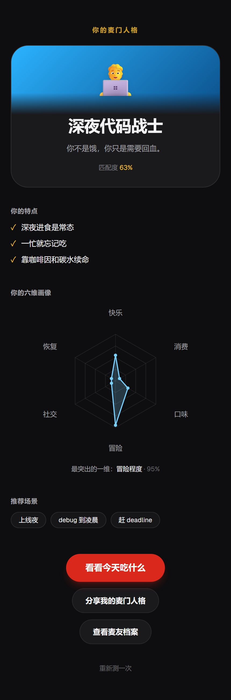
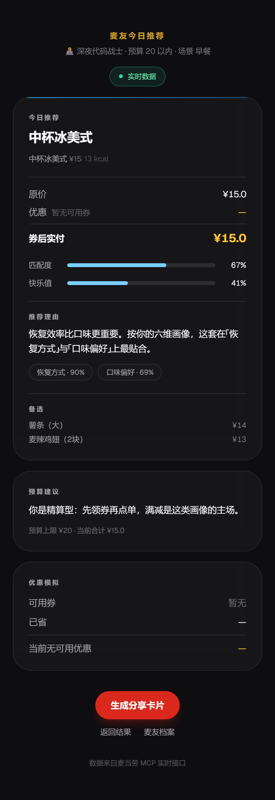
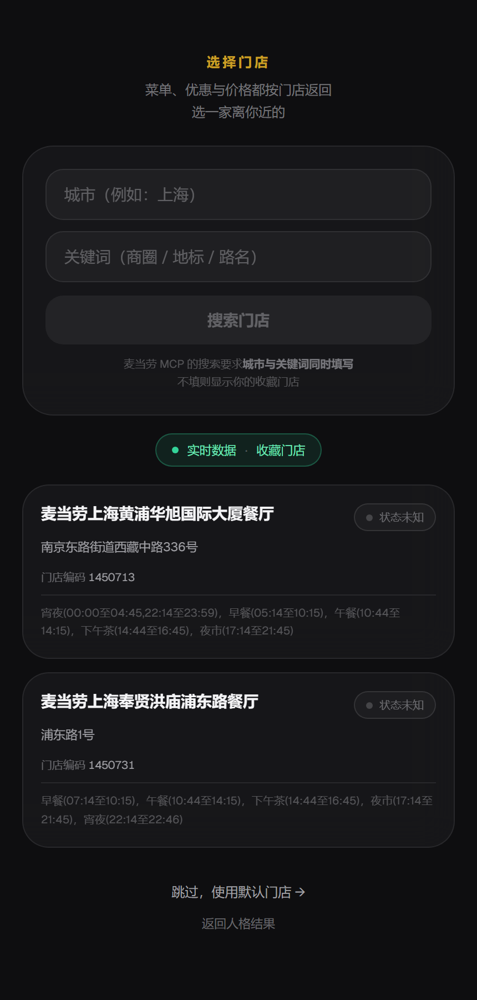

# 🍔 McBuddy AI · 麦麦搭子

**一个会认识你的 AI 麦当劳搭子。**

> 第一次见面，它认识你。以后，它记得你。

<p>
  
  
  
  
  
  
</p>

<p align="center">
  
</p>

---

## 它是什么

一个「先认识你，再记住你，最后替你拿主意」的麦门体验。走完八步，你会拿到一份
**按自己人格与所选门店算出来的今日推荐**，和一张**可截图分享的人格海报**：

```
① 首页            →  3 秒理解这是什么
② 人格测试        →  6 道情景题，30 秒
③ AI 分析动画     →  约 2.6 秒的仪式感
④ 人格结果        →  六维画像 + 人格卡（截图主战场）
⑤ 选择门店        →  按城市/关键词搜门店，菜单与价格都按它返回
⑥ 麦友今日推荐    →  按人格算出的套餐 · 券后价 · 预算建议
⑦ 麦友档案        →  「AI 记得你的 3 件事」
⑧ 分享卡片        →  3:4 竖版海报，一键保存 PNG
```

<p align="center">
  
  <br>
  <sub>分享海报 · 一键导出 PNG（3 倍像素）</sub>
</p>

### 三个真正的不同

| | |
|---|---|
| **🧠 它记得你** | 不是随机推荐。六道题驱动一个六维向量，与八种人格原型做中心化余弦匹配；同样的作答永远得到同样的结果——**可解释、可复现、无幻觉** |
| **🔌 真的接了 MCP** | 已用真实 Token 实测通过：JSON-RPC 握手成功、服务端 35 个工具、取到 160 条真实营养数据与真实门店。**不是 mock，不是占位** |
| **🛡 降级也诚实** | 接口的 `source` 字段如实标注数据来自实时还是演示，页面同步显示徽标。门店打烊时自动降级并明确告知——**绝不把 Mock 谎报成实时** |

### 它不是什么

- ❌ 不是点餐工具（**只读接入**，不支持下单）
- ❌ 不是聊天机器人（没有对话界面，也没有接入 LLM）
- ❌ 不是麦当劳官方产品（个人参赛作品）

---

## 60 秒跑起来

```bash
git clone https://github.com/wangzaizz1545/maimai-buddy.git
cd maimai-buddy
```

**Windows**：双击 `start.bat`
**macOS / Linux**：`./start.sh`

浏览器会自动打开 <http://127.0.0.1:8000>

> ✅ 只需要 **Python 3.10+**
> ✅ **不需要** Node.js（前端静态产物已随仓库提交）
> ✅ **不需要** 申请任何 Token 即可完整体验（可选接入真实 MCP，见 [配置指南](docs/MCP_SETUP.md)）

---

## 它是怎么工作的

### 数据链路

```
浏览器  /recommend 页面
    │  只发送人格向量与预算，不含任何凭证
    ▼
前端 Provider 层              frontend/lib/provider/
    │  HTTP 优先，失败自动降级到本地演示数据
    ▼
FastAPI 推荐接口              backend/api/recommend.py
    │  GET  /api/recommend/menu · /promotions
    │  POST /api/recommend/calculate
    ▼
MCP Adapter                   backend/mcp/adapter.py
    │  Provider 选择 + 失败降级 + source 诚实标记
    │
    ├── MCBUDDY_MCP=fixture ──► MockProvider ──► fixtures/*.json
    │
    └── MCBUDDY_MCP=live ─────► LiveProvider
                                    │  Streamable HTTP + JSON-RPC 2.0
                                    │  Authorization: Bearer <MCD_MCP_TOKEN>
                                    ▼
                             https://mcp.mcd.cn   （麦当劳中国官方 MCP Server）
```

> **MCP Token 只存在于后端环境变量**，前端与浏览器全程接触不到任何凭证。

<p align="center">
  
  <br>
  <sub>今日推荐页 · 顶部徽标如实标注数据来自实时还是演示</sub>
</p>

### 真实调用链

`query-meals` / `query-store-coupons` / `calculate-price` 都**强制要求门店编码**，
因此真实链路是「先解析门店，再查数据」：

```
query-nearby-stores  →  storeCode
        ↓               （用户在 /store 页选择，或回退到收藏门店）
        ├─ query-meals          门店可售菜单
        ├─ query-store-coupons  该门店可用优惠券
        └─ calculate-price      权威价格（唯一价格来源）
```

> 门店搜索接口有个真实约束：**城市与关键词必须同时提供**（只给一个会返回 `600058`）。
> 因此 `/store` 页要求两项都填才允许搜索，不填则展示收藏门店。
> 另外**只有城市搜索会返回营业状态**，收藏门店不返回——所以页面上会区分
> 「已打烊」与「状态未知」，不会把未知当成打烊。

<p align="center">
  
  <br>
  <sub>门店选择页 · 展示真实 MCP 返回的门店、地址、门店编码与营业时段</sub>
</p>

### 降级：三层兜底，且绝不谎报

| 层 | 触发条件 | 结果 |
|---|---|---|
| 前端 Provider | 后端不可用 / 超时 4s | 改用前端本地演示数据 |
| MCP Adapter | Live 调用抛任何异常 | 改用后端演示数据 |
| Provider | 门店打烊、无券等业务限制 | 向上抛错，触发降级 |

**降级后 `source` 一律标记为 `"mock"`**，接口响应与页面徽标同步如实显示——

> 宁可显示演示数据，也绝不把 Mock 谎报成实时数据。

完整说明见 [`MCP_INTEGRATION.md`](MCP_INTEGRATION.md)。

---

## 八种麦门人格

不是复制 MBTI，而是一个**六维向量模型**——六个维度各自独立计分，再与八个人格原型做相似度匹配。

| | 人格 | 一句话 |
|---|---|---|
| 🍟 | 黄金薯条治愈者 | 一份薯条，能把今天按回原位。 |
| ☕ | 咖啡续命玩家 | 我不困，我只是需要一杯。 |
| 🍔 | 巨无霸掌控者 | 世界很乱，至少分量是确定的。 |
| 🌶 | 麦辣冒险家 | 辣一下，才知道自己还活着。 |
| 🍦 | 甜品疗愈师 | 甜的那一口，是给情绪的。 |
| 💰 | 精打细算麦友 | 不是花不起，是不想亏。 |
| 👥 | 分享快乐玩家 | 一个人吃是吃饭，一起吃才是过节。 |
| 🧑‍💻 | 深夜代码战士 | 你不是饿，你只是需要回血。 |

### 六个维度

| 维度 | 两极 |
|---|---|
| 快乐需求 | 吃饭是任务 ↔ 吃饭是补偿 |
| 消费态度 | 极致省钱 ↔ 体验优先 |
| 口味偏好 | 经典咸香 ↔ 刺激 / 甜 |
| 冒险程度 | 只点老几样 ↔ 新品必试 |
| 社交属性 | 独食 ↔ 分享 / 组局 |
| 恢复方式 | 激活（咖啡因） ↔ 安抚（糖分） |

> 每道题恰好驱动一个维度，因此结果页可以解释「你的某一维来自第几题」，
> 而不是给出一堆无法追溯的数字。约 **17.9%** 的作答会命中**混合型**（双人格）。

---

## 当前状态（诚实说明）

本仓库为 **v0.2**，已完成麦当劳 MCP 真实接入。为避免误导，明确列出边界：

### ✅ 已实现

| 能力 | 说明 |
|---|---|
| 七页完整流程 | 首页 → 测试 → 分析 → 结果 → 推荐 → 档案 → 分享卡，无断链 |
| 六维人格模型 | 6 题 ↔ 6 维，含溢出（spillover）影响 |
| 匹配算法 | 中心化余弦相似度 + 混合型判定 + 置信度 |
| 8 种人格 | 每型含描述、特点、推荐理由、推荐场景、专属渐变、分享文案 |
| **麦当劳 MCP 真实接入** | Streamable HTTP + Bearer 鉴权；服务端 35 个工具；已实测取到真实门店、营养、活动数据 |
| **今日推荐引擎** | 五轴加权匹配 + 预算硬约束 + 券组合 + 凑单建议 + 预算外升级提示 |
| **数据来源可切换** | `fixture`（演示数据）/ `live`（真实 MCP），**失败自动降级且如实标注** |
| 本地状态 | localStorage 三层状态，**刷新不丢进度**，带版本前缀 |
| 六维雷达图 | 纯手写 SVG，无图表库依赖 |
| 人格主题系统 | 8 套视觉（背景 / 光晕 / 卡片 / 描边）由同一函数派生 |
| 分享海报 | 3:4 竖版，支持**一键导出 PNG**（3 倍像素） |
| 零依赖启动 | 双击即用，启动器自动建环境、装依赖、起服务、开浏览器 |
| 算法自检 | 四个验证脚本：穷举 6144 组作答、三页数据链路、推荐引擎、MCP 连通性 |

### ⚠️ 真实 MCP 的边界

| 情况 | 行为 |
|---|---|
| 门店营业中 | 菜单、优惠券、价格来自真实 MCP，`source` 标记为 `mcp` |
| 门店已打烊 / 无券 / 网络异常 | **自动降级**到本地演示数据，`source` 标记为 `mock`，界面显示「演示数据」 |
| 未配置 Token | 直接使用演示数据，不会报错 |

> **降级时绝不会把演示数据谎报成实时数据**——这是项目的硬性原则，已在代码、接口与界面上三重保证。

### 🚧 尚未实现（请勿误认为已有能力）

| 规划能力 | 现状 |
|---|---|
| **LLM 对话** | ❌ 未接入任何大模型 |
| **Agent 推理管线** | ❌ `agent/` 仅为占位包 |
| **长期记忆** | ❌ `memory/` 仅为占位包；当前档案为 Mock 数据 |
| **数据持久化** | ❌ `database/` 仅保留建表脚本，服务端未使用 SQLite |

> `/analysis` 页的四步动画是**纯视觉呈现**，不涉及 AI 计算。
> 人格结果与今日推荐都由确定性算法得出——同样的作答永远得到同样的结果，无幻觉、可复现。

MCP 接入的完整说明见 [`MCP_INTEGRATION.md`](MCP_INTEGRATION.md)。

---

## 技术栈

| 层 | 选型 |
|---|---|
| 前端 | Next.js 14（App Router）· TypeScript · Tailwind CSS · Framer Motion |
| 前端交付 | **静态导出**（`output: "export"`），产物入库，访客无需 Node |
| 后端 | Python · FastAPI（推荐数据接口 + 静态托管） |
| 图像导出 | html-to-image（动态 import，不进首屏包） |
| 状态 | localStorage（无账号、无服务端会话） |
| 协议 | **麦当劳 MCP（Model Context Protocol）— 已接入**，Streamable HTTP + Bearer 鉴权 |
| HTTP 客户端 | httpx（后端唯一网络依赖） |

---

## 项目结构

```
maimai-buddy/
├── README.md                  项目说明
├── CONTEST_DECLARATION.md     参赛声明（官方原文）
├── MCP_INTEGRATION.md         ★ MCP 接入说明
├── mcp-config.example.json    脱敏的 MCP 配置示例
├── start.bat / start.sh       一键启动入口（纯 ASCII，仅负责找到 Python）
├── scripts/launch.py          启动逻辑：建环境 → 装依赖 → 起服务 → 开浏览器
│
├── frontend/                  ★ 全部业务实现都在这里
│   ├── app/                   8 个页面（/, /personality, /analysis, /result,
│   │                                      /store, /recommend, /buddy, /share）
│   ├── components/            11 个组件
│   ├── data/                  题库 · 8 型人格 · 档案 Mock · 推荐演示数据 · 门店演示数据
│   ├── lib/                   类型 · 匹配算法 · 推荐引擎 · 状态 · 主题派生
│   │   ├── storeSelection.ts  ★ 已选门店的持久化（独立于冻结的 store.ts）
│   │   └── provider/          ★ 数据源抽象：HTTP 优先 + Mock 兜底
│   ├── scripts/               四个验证脚本
│   └── out/                   静态导出产物（入库，供 FastAPI 托管）
│
├── backend/
│   ├── api/
│   │   ├── recommend.py       菜单 · 券 · 算价
│   │   └── store.py           ★ 门店搜索
│   └── mcp/                   ★ MCP Adapter
│       ├── config.py          唯一读取 MCP 环境变量的地方
│       ├── adapter.py         Provider 选择 + 降级 + source 标记
│       ├── live_provider.py   真实 MCP（Streamable HTTP）
│       ├── mock_provider.py   演示数据（离线兜底）
│       ├── normalize.py       外部数据 → schema
│       ├── schemas.py         数据契约
│       └── errors.py          异常体系
│
├── fixtures/                  演示数据（真实 MCP 不可用时的兜底）
├── docs/                      架构 · 创新点 · 开发计划
│
├── agent/  memory/  persona/  database/    ← 占位包，接口预留
└── .env.example
```

> **关于占位包**：`agent/` `memory/` `persona/` 目前只有说明性 `__init__.py`。
> 需要特别注意——**人格模型的实现不在 `persona/`，而在 `frontend/data/` 与 `frontend/lib/`**。
> MCP 实现位于 `backend/mcp/`（Phase 2 遗留的根目录 `mcp/` 占位包已删除）。

---

## 本地开发

```bash
# 后端
python -m venv .venv
.venv/bin/python -m pip install -r backend/requirements.txt   # Windows: .venv\Scripts\python.exe
cp .env.example .env                                          # Windows: copy .env.example .env
.venv/bin/python -m uvicorn backend.main:app --reload

# 前端（改动后必须重新构建，产物才会更新）
cd frontend && pnpm install && pnpm build
```

| 地址 | 说明 |
|---|---|
| <http://127.0.0.1:8000> | 应用首页 |
| <http://127.0.0.1:8000/health> | 健康检查 |
| <http://127.0.0.1:8000/api> | 运行模式信息（含 `mcp: fixture \| live`） |
| `/api/recommend/menu` | 推荐菜单（支持 `?storeCode=`，响应含 `source` 数据来源标记） |
| `/api/recommend/promotions` | 该门店优惠券 |
| `POST /api/recommend/calculate` | 价格计算 |
| `/api/store/search` | 门店搜索（对应 MCP `query-nearby-stores`） |

### 验证脚本

```bash
# 前端：人格模型与推荐引擎
cd frontend
pnpm dlx tsx scripts/verify-personas.ts    # 穷举 6144 组作答，验证 8 型全部可达
pnpm dlx tsx scripts/verify-ui-data.ts     # 验证结果/档案/分享三页渲染数据完整
pnpm dlx tsx scripts/verify-recommend.ts   # 推荐引擎：8 型差异度 + 预算约束 + 券计算自洽
pnpm dlx tsx scripts/verify-provider.ts    # 数据源抽象层与降级路径
pnpm dlx tsx scripts/verify-recommend-flow.ts   # 页面取数链路：source 标记与徽标逻辑

# 后端：MCP 接入（含真实连通性冒烟测试）
cd ..
.venv/Scripts/python.exe backend/verify_mcp.py     # Windows
.venv/bin/python backend/verify_mcp.py             # macOS / Linux
```

---

## 常见问题

**Q：提示 `Python not found`**
未安装 Python 或安装时未勾选 "Add Python to PATH"。到
<https://www.python.org/downloads/> 安装 3.10+ 后重试。

**Q：浏览器打开是空白页**
前端静态产物缺失或损坏：`cd frontend && pnpm install && pnpm build`。

**Q：端口 8000 被占用**
启动器检测到已有服务会直接打开浏览器，不会重复启动。

**Q：人格会变吗？**
同样的作答永远得到同样的人格。若想试其他结果，在结果页点「重新测一次」。

**Q：今日推荐的价格是真的吗？**
取决于数据来源：

- 配置了 `MCD_MCP_TOKEN` 且 `MCBUDDY_MCP=live`，**门店营业中** → 菜单与价格来自真实 MCP
- 门店打烊、无券或网络异常 → 自动降级为本地演示数据
- 未配置 Token → 直接使用演示数据

接口响应里的 `source` 字段会如实标注是 `mcp` 还是 `mock`，页面顶部也会显示对应徽标。
**降级时不会把演示数据谎报成实时数据。** 参见 [`MCP_INTEGRATION.md`](MCP_INTEGRATION.md)。

**Q：想接入自己的 Token？**
在项目根目录的 `.env` 中填入 `MCD_MCP_TOKEN`，并把 `MCBUDDY_MCP` 设为 `live`，
然后重启后端、运行 `backend/verify_mcp.py` 验证连通性。

---

## 文档

| 文档 | 内容 |
|---|---|
| [`MCP_INTEGRATION.md`](MCP_INTEGRATION.md) | **MCP 接入说明**：架构、工具清单、调用流程、降级机制、安全说明 |
| [`docs/MCP_SETUP.md`](docs/MCP_SETUP.md) | **MCP 配置与排错**：Token 配置、启动、验证命令、错误码排查 |
| [`docs/ARCHITECTURE.md`](docs/ARCHITECTURE.md) | 架构设计：运行形态、状态链、匹配算法、组件边界、已实现/未实现对照 |
| [`docs/INNOVATION.md`](docs/INNOVATION.md) | 创新点说明：每个创新点都标注了可核验的代码位置 |
| [`docs/DEV_PLAN.md`](docs/DEV_PLAN.md) | 开发计划与竞争分析（Phase 1 历史文档） |

---

## 更新日志

### v0.2.1（健壮性与可访问性优化）

本轮不新增功能，聚焦**稳定性、可访问性与代码卫生**：

**后端健壮性**
- 输入校验：`CartItem.qty` 限定 `1–99`，算价请求 `items` 强制非空，杜绝 0/负价格与异常请求
- 并发安全：`adapter` 用锁保护 Provider 初始化（消除 check-then-act 竞态），`_last_source` 改为 `ContextVar` 按请求隔离，避免并发请求串写「数据来源」标注
- 缓存治理：`live_provider` 的 `_cached` 加锁防缓存击穿、门店解析加 TTL（不再永久缓存）、缓存条目设上限 + 输入长度限制（防内存膨胀）
- 容错缺口：`to_meal` / mock 的匹配轴解析改用宽松取数，真实数据中单条记录带 `null` 字段不再拖垮整批降级
- 营业状态：`to_store` 支持字符串/数字真值（`"1"`/`"true"`/`"open"` 等），不再把非 `bool` 状态静默丢弃成「未知」
- 数据契约：`PromotionsResponse` 补齐 `source`/`fetchedAt`，`PriceQuote` 补齐 `fetchedAt`，`Store` 增加 `city` 字段

**前端可访问性与一致性**
- 全站动画接入 `MotionConfig reducedMotion="user"`，尊重系统的「减少动态效果」设置
- 深色主题声明 `color-scheme: dark`，原生表单控件与滚动条以深色渲染
- 人格测试题卡补充 `role="group"` 与标题关联；切题后自动聚焦新题，键盘用户不再丢失焦点
- 门店搜索改用原生 `<form>` 语义，输入框补 `<label>`；搜索加请求序号防竞态
- 修复无效的 Tailwind 透明度类（`border-white/8`、`/12` → 任意值写法）
- 提升多处低对比度文字（`text-muted/25`、`/40`、`/45`、`/50` → 更高对比度），装饰性 emoji 补 `aria-hidden`
- 推荐引擎魔法数字提取为命名常量（快乐值权重、差价阈值）

---

## 声明

本项目为「麦当劳程序员创意开发大赛」参赛作品，由参赛者独立开发，**非麦当劳官方产品**。
项目输出仅供参考，不构成医疗、营养或其他专业建议；餐品信息、价格及供应状态以麦当劳官方渠道的实时结果为准。

配色为品牌灵感设计，**不使用麦当劳官方 Logo**。

---

**如果这个项目让你觉得有点意思，欢迎点个 ⭐ Star。**
