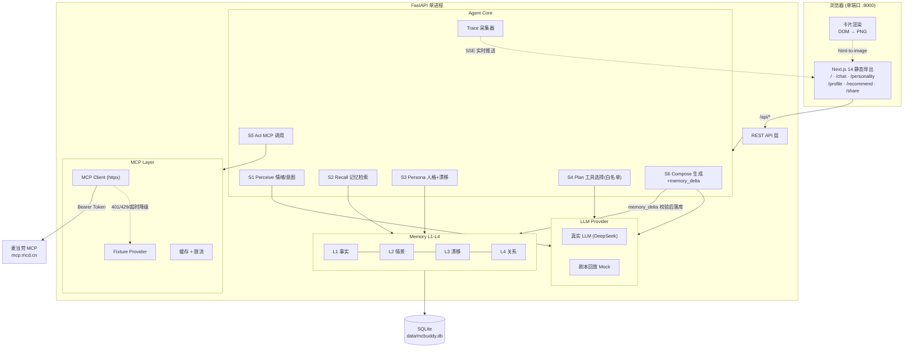

# McBuddy AI（麦麦搭子）完整开发计划 · Phase 1

> 交付物：PRD + 架构设计 + 数据结构 + 开发计划
> 约束：**本阶段不写代码**，等确认后进入 Phase 2
> 当前时间：2026-10-12 23:55 ｜ 报名截止 10/25 23:59 ｜ 定榜 10/26 00:00
>
> **v1.1（决策已锁定）**：6 项决策已确认，环境预检已通过，公网只读 Demo 已纳入计划。
> 状态：✅ Phase 1 完成，等待"进入 Phase 2"指令。

---

## 0. 给合伙人的结论摘要

### 0.1 三句话

1. **产品方向成立，但"情绪搭子"这个位置已经被占了。** 我在赛场上找到直接竞品 `McD_MentalCare_Buddy`（麦当劳「打工人精神续命」搭子），它已经做了"情绪输入 → 套餐 + 券 + 发疯文学文案"，而且零依赖、离线可跑、149 项测试。**如果 McBuddy 只是"情绪化点餐"，会正面撞车且打不过。**
2. **我们唯一守得住的东西是"记忆"。** 那是个单次工具（输入一句 → 输出方案，不留痕）。McBuddy 是**有身份、有档案、会成长**的搭子。所有资源必须压在这一条上。
3. **技术栈要收敛，但不是降级。** 保留 Next.js + FastAPI 的体验上限，通过「静态导出 + 单进程托管 + 双击启动 + 零 Key 演示模式」把访客的启动成本降到接近零。**全栈不是风险，跑不起来才是风险。**

### 0.2 决策已锁定（v1.1）

| # | 决策 | 锁定结果 | 影响 |
|---|---|---|---|
| D1 | 仓库命名 | ✅ **`maimai-buddy`**（品牌仍为 McBuddy AI · 麦麦搭子） | 避开 `mcbuddy-ai` 组织与 4 个 buddy 项目 |
| D2 | 交付形态 | ✅ **单进程 + 静态导出 + 双击启动 + 零 Token 零 Key 可跑** | 访客只需 Python，不需要 Node、不需要申请 Token |
| D3 | LLM 策略 | ✅ **Phase 6 只做剧本模式（replay）**，真实 LLM 推迟 | 省约 3h；provider 抽象保留，接真 LLM 只需改一个环境变量 |
| D4 | 公网 Demo | ✅ **做只读限额版**（P10，10/20–10/21） | 需 +5h；规格见 3.8.2，且与 D3 天然互补 |
| D5 | 卡片渲染 | ✅ 前端 DOM → PNG（`html-to-image`，**本地 vendor，不用 CDN**） | 保证离线模式样式不丢 |
| D6 | 数据库 | ✅ SQLite only | 砍掉 PostgreSQL |
| D7 | 投入时间 | ✅ **4–6 小时/天** | 匹配排期，但**零余量**，必须执行降级顺序（见 6.4） |

> 💡 **D3 与 D4 的意外互补**：剧本模式让公网 Demo 变成**零 API 成本**——访客再多也不会烧你的 LLM 账单。这让"做公网只读版"的风险从"中"降到"低"。

### 0.3 技术预检结果（已实测，全部通过）

我在动工前对这台机器做了实机验证，避免把环境问题拖到 Phase 7 才爆：

| 检查项 | 结果 | 影响 |
|---|---|---|
| 系统 Python | ✅ 3.14.7（`D:\python\python.exe`） | — |
| **FastAPI 栈在 Python 3.14 上可装** | ✅ fastapi 0.143.0 · uvicorn 0.54.0 · httpx 0.28.1 · pydantic 2.14.1（**预编译 wheel 齐全，无需 Rust 编译**） | ⚠️ 这是最大风险点，已排除 |
| venv | ✅ 已创建 `mcbuddy-ai/.venv` | Phase 2 可直接用 |
| pip 网络 | ✅ 可访问 PyPI | — |
| **Node.js** | ⚠️ 系统未安装，但 DSH 自带 **v24.21.0** | 构建前端够用；**访客仍只需 Python**（因为 `out/` 入库） |
| pnpm | ✅ 11.7.0（DSH 自带） | — |
| sqlite3 | ✅ 标准库内置 | — |

> ⚠️ **待 Phase 2 首日验证**：Next.js 14.2 官方支持 Node 18.17+，在 Node 24 上可能有边缘告警。若构建异常，**改用 Next.js 15**（对 Node 24 支持更完整）——这只影响构建工具版本，不影响任何产品设计。

---

## 1. 竞争情报与定位校准

### 1.1 赛场态势（官方 RANKING.md，2026-10-12 23:00 快照）

| 事实 | 数据 | 对我们的含义 |
|---|---|---|
| 排名只看 Star | 第 1 名 204★，进榜门槛约 5★ | Star 是唯一 KPI |
| 参赛量 | 500+ 报名 Issue | 同质化严重，必须靠"一眼不同"取胜 |
| 时间 | 今天 10/12，报名截止 10/25 | **只剩 13 天，且 Star 需要时间累积** |

### 1.2 直接竞品拆解（这是本计划最重要的一节）

#### 🔴 头号竞品：`shy1658/McD_MentalCare_Buddy`（麦麦「打工人精神续命」搭子）

| 维度 | 它的做法 | 我们的机会 |
|---|---|---|
| 定位 | "听得懂你今天有多惨，并给你算好券的 AI 搭子" | **同一句话术**，必须换赛道 |
| 交互 | 输入一句精神状态 → 输出方案 | 无身份、无记忆、无回访 |
| 输出 | 续命值 RP 评分 + 套餐 + 最优券组合 + 发疯文学 | 我们做**人格身份 + 长期档案** |
| 形态 | CLI / Python Skill，零第三方依赖 | 我们做 **Web 产品级视觉**（Wrapped 感） |
| 工程 | 离线可跑、`--doctor` 自检、149 项断言测试 | 它的工程分很高，我们不比这个 |
| 安全 | 心理危机硬拦截 | **我们必须也有**（否则合规与口碑都吃亏） |
| 弱点 | ⚠️ **单次工具，不留记忆**；纯文本，视觉弱；无分享物设计 | ✅ 这就是我们的整个生存空间 |

#### 🟡 相邻竞品

| 项目 | 占位 | 威胁 |
|---|---|---|
| `mcd-time-anchor`（麦味时光锚点） | 一句话点单 + "点餐时光记忆" | 也提记忆，但记忆是点餐副产物，不是产品主体 |
| `mcd-mbti` 37★ | 16 型麦门人格 | 人格测试已是红海，但**均为问卷式，无记忆、无演化** |
| `McLife-Desk` 58★ | 桌面/生活管家 | 命名撞车（McLife） |
| `mcpet` | 桌面宠物搭子 | 形态不同，不直接冲突 |
| `mcd-memory-can` 11★ / `mcd-order-memory` 8★ | 记忆类雏形 | 说明"记忆"正在被注意，但都还浅 |

#### Buddy 命名已泛滥

榜上已有：`mcd-party-buddy` 23★、`mac-Buddy` 21★、`mcd-health-buddy` 9★、`mcd-fit-buddy` 5★。
另外 GitHub 上 `mcbuddy-ai` 这个组织已被一个 Minecraft 项目占用。**"McBuddy" 在 GitHub 搜索里会严重被稀释。**

### 1.3 我们唯一可守的差异化：记忆

```
竞品：一句情绪 ──→ 一个方案           （无状态，每次都是第一次见面）
McBuddy：一次测试 ──→ 一个身份 ──→ 一段记忆 ──→ 越用越准
                     ↑ 获客钩子      ↑ 唯一壁垒      ↑ 传播物
```

**新 slogan（建议替换原标题）：**

> 🍔 **McBuddy AI · 麦麦搭子**
> **第一次见面它问你是谁，第二次它已经知道你今天为什么来。**
>
> 不是点餐机器人。是唯一会**记住你**的麦门搭子。

**三条护城河（必须都做，少一条就被抄）：**

| # | 护城河 | 一句话证明 |
|---|---|---|
| M1 | **身份** | 六维人格 → 8 型身份，用户有"我是谁" |
| M2 | **记忆** | 可见的麦友档案，会累积、会纠错、会漂移 |
| M3 | **演化** | 人格会变："你从 🍟 黄金薯条治愈者 漂向了 💰 精打细算麦友" |

**M3「人格漂移」是我最看好的一条**：它天然产生二次分享的内容（对比截图），而且竞品完全无法在一个单次工具里复制。

### 1.4 命名建议

| 用途 | 建议 | 理由 |
|---|---|---|
| 产品品牌 | **McBuddy AI · 麦麦搭子** | 保留你的品牌资产，口语好记 |
| GitHub 仓库 | **`maimai-buddy`**（备选 `mcbuddy-mcd`） | 避开 `mcbuddy-ai` 组织与 4 个 buddy 项目，搜索唯一性强 |
| README 标题 | `🍔 McBuddy AI · 麦麦搭子 (maimai-buddy)` | 品牌 + 关键词双覆盖 |

---

## 2. PRD

### 2.1 一句话定位

> 一个会记住你的 AI 麦当劳搭子：先做一次麦门人格测试建立身份，之后每次对话它都带着你的档案、状态与真实 MCP 数据，给你此刻最合适的方案。

### 2.2 产品闭环（你的设计的强化版）

```
【获客】人格测试（60 秒，零门槛）
   ↓
【建立身份】麦门人格 + 六维向量  → 写入麦友档案
   ↓
【留存】AI 记得你（可见记忆 + 可纠错 + 人格漂移）
   ↓
【技术证明】Agent 6 阶段推理链可视化 + 真实 MCP 调用
   ↓
【传播】分享卡片（人格 / 推荐 / 漂移对比三种模板）
   ↓
【回流】朋友扫码 → 做测试 → 回到第一步
```

**每一环都必须有产物落盘**，否则评委看不到。

### 2.3 目标用户

| 用户 | 场景 | 需求 | 我们给 |
|---|---|---|---|
| **主用户**：18–35 岁打工人/程序员 | 加班后、深夜、被甲方折磨后 | 不想做选择，想被理解 | 一句话 → 一个方案 + 一句懂你的话 |
| **传播用户**：爱晒的社交用户 | 摸鱼、周五 | 一个"说我"的东西 | 人格卡 + 漂移对比图 |
| **评委/开发者** | 评估要不要 Star | 真不真、跑不跑得起来 | 双击启动 + Agent trace + 真 MCP |

### 2.4 功能需求

#### F1 · 麦门六维人格测试（P0，获客入口）

**设计原则：不做 MBTI，做"可量化的六维向量"。**

| 维度 | 代号 | 0 端 | 1 端 | 数据来源 |
|---|---|---|---|---|
| 1 快乐需求 | `happiness_need` | 低（吃饭是任务） | 高（吃饭是补偿） | 问卷 / 订单频次 |
| 2 消费态度 | `spending` | 极致省钱 | 体验优先 | 券使用率 / 客单价 |
| 3 口味偏好 | `taste` | 经典咸香 | 刺激/甜 | 品类分布 |
| 4 冒险程度 | `adventure` | 只点老几样 | 新品必试 | 新品占比 / 活动参与 |
| 5 社交属性 | `social` | 独食 | 分享/组局 | 单均件数 / 多人订单 |
| 6 恢复方式 | `recovery` | 激活（咖啡因） | 安抚（糖分/碳水） | 咖啡 vs 甜品占比 |

**双模式测试（关键设计）：**

| 模式 | 输入 | 耗时 | 定位 | 权重 |
|---|---|---|---|---|
| **快测** | 6 道情景题（无需 Token） | 60 秒 | 获客主路径，人人可玩 | 维度 100% 来自问卷 |
| **真测（认证版）** | 6 题 + 接入 MCP 读真实订单 | 90 秒 | 技术证明 + 高可信 | 真实数据 70% + 问卷 30% |

两种模式产出**同一种六维向量**，走同一套匹配逻辑 —— 架构干净，且"真测"给用户升级动机。

**8 种人格原型（六维向量原型值）：**

| # | 人格 | emoji | HN | SA | TP | AD | SO | RM | 特点 | 推荐理由 | 推荐场景 |
|---|---|---|---|---|---|---|---|---|---|---|---|
| 1 | 黄金薯条治愈者 | 🍟 | 0.90 | 0.40 | 0.35 | 0.30 | 0.35 | 0.80 | 压力大时需要快乐补偿 | 经典咸香 + 熟悉感最能安抚 | 加班后、被骂后、深夜 |
| 2 | 咖啡续命玩家 | ☕ | 0.60 | 0.50 | 0.60 | 0.45 | 0.30 | 0.15 | 靠咖啡因维持能量 | 提神效率优先于口味 | 早会前、通宵、下午困 |
| 3 | 巨无霸掌控者 | 🍔 | 0.80 | 0.60 | 0.40 | 0.25 | 0.40 | 0.75 | 追求高满足感与确定感 | 分量与满足感是核心指标 | 发薪日、犒劳自己 |
| 4 | 麦辣冒险家 | 🌶 | 0.60 | 0.60 | 0.85 | 0.90 | 0.55 | 0.40 | 喜欢尝新与刺激 | 新鲜度权重最高 | 新品上市、周末 |
| 5 | 甜品疗愈师 | 🍦 | 0.85 | 0.55 | 0.90 | 0.50 | 0.50 | 0.90 | 重视情绪价值 | 甜味直接作用于情绪 | 心情低落、生理期、奖励 |
| 6 | 精打细算麦友 | 💰 | 0.40 | 0.10 | 0.40 | 0.30 | 0.35 | 0.50 | 追求性价比 | 券后单价是唯一指标 | 月末、日常 |
| 7 | 分享快乐玩家 | 👥 | 0.70 | 0.60 | 0.55 | 0.60 | 0.95 | 0.50 | 喜欢和朋友一起吃 | 分量与分享属性优先 | 聚会、团建、约会 |
| 8 | 深夜代码战士 | 🧑‍💻 | 0.85 | 0.45 | 0.55 | 0.50 | 0.20 | 0.25 | 程序员 / 夜间 / 高压 | 恢复效率 + 高满足感 | 22:00 后、上线夜、debug 中 |

> 维度简写：HN 快乐需求｜SA 消费态度｜TP 口味｜AD 冒险｜SO 社交｜RM 恢复方式

**匹配算法（规则，非训练）：**
1. 每题选项映射为维度增量（-1 / 0 / +1，带权重），归一化到 `[0,1]`
2. 与 8 个原型向量做**加权余弦相似度**
3. 取 Top1 为本命人格；若 Top1 与 Top2 相似度差 **< 0.05** → 判定为**混合型**（如「🍟 黄金薯条治愈者 × 🧑‍💻 深夜代码战士」）
4. `confidence` = 相似度差值映射到 60–99%

> 💡 **混合型是传播放大器**：双人格比单人格更"准"、更有晒图欲，且让"我测出来和别人不一样"成立。

**人格结果页必须包含（对应你的要求）：**
人格名称 · emoji · 一句话描述 · 用户特点（3 条）· 推荐理由 · 推荐场景 · 六维雷达图 · 本命单品方向 · 雷区 · 分享文案

**合规红线**：**不输出"全国仅 X% 的人是你这种"**。改为「行为强度 88/100」或标注来源与样本量的分位。大赛规则明确要求真实性。

#### F2 · AI 麦友档案 / Memory（P0，核心壁垒）

**记忆分四层（这是技术护城河，写进 README 会很亮眼）：**

| 层 | 名称 | 内容 | 示例 |
|---|---|---|---|
| L1 | 事实记忆 | 结构化 KV：预算、口味、忌口、常点门店 | `budget_range = "30-50"` |
| L2 | 情景记忆 | 每次对话的事件摘要 + 情绪 + 时间 | "10/12 深夜 因线上事故来求助" |
| L3 | 人格漂移 | 六维向量的时间序列 | `10/12 [0.9,0.4,...] → 10/20 [0.7,0.2,...]` |
| L4 | 关系记忆 | 互动次数、连续天数、它对你的印象 | "第 7 次见面，它记得你不吃香菜" |

**写入策略（防幻觉污染，关键工程点）：**
- LLM **不允许**直接写库
- 每轮对话后，Agent 只能输出结构化 `memory_delta` JSON
- 经 **schema 校验 + key 白名单 + 置信度阈值** 后才落库
- 低置信度记忆标记为 `pending`，在 /profile 中请求用户确认

**读取策略（token 预算控制）：**
`全部 L1（≤300 token）+ 最近 5 条 L2 + L3 漂移摘要 + L4 关系摘要`

**可见性设计（"AI 真的认识我"的具象化）：**
- `/profile` 展示「AI 记得你的 N 件事」，每条**可删除、可纠正**（点"这不对"）
- 这是"真 Agent"的强信号，也让隐私可控

**麦友码（Buddy Code）：** 把画像 + 记忆导出为一段可粘贴的字符串，可在另一台设备恢复 → **无账号实现跨设备记忆**。这是聪明的 hack，评委喜欢。

#### F3 · AI 麦友聊天（P0）

**交互流程（你的要求，强化为可观测的 6 阶段）：**

```
用户输入
  → S1 Perceive  理解情绪与意图
  → S2 Recall    读取麦友档案（L1-L4）
  → S3 Persona   加载人格向量，计算是否漂移
  → S4 Plan      决定需要哪些 MCP 工具（白名单内）
  → S5 Act       调用 MCP（含缓存/重试/降级）
  → S6 Compose   生成回答 + 推荐 + memory_delta
```

**示例对话（验收标准）：**

> **用户**：今天线上事故，好累。
>
> **AI**：我记得你是 🧑‍💻 **深夜代码战士**，第 7 次见面了。
> 上次这种时候你点了麦辣鸡腿堡 + 冰美式，说"辣一下才清醒"。
> 现在是 23:40，我看了一下今天的可售菜单和你能用的券 ——
> **建议：麦辣鸡腿堡套餐 + 中杯冰美式，券后 ¥26.5（省 ¥7）**
> 恢复效率 92 分。要不要我换个低卡的版本？

**必须体现的三个"记得"**：记得人格、记得历史选择、记得场景（时间/预算）。

#### F4 · MCP 智能推荐（P0）

**工具白名单（只读优先，9 个）：**

| 工具 | 用途 | 必需 |
|---|---|---|
| `now-time-info` | 时段判断（早餐/正餐/夜宵） | P0 |
| `query-nearby-stores` | 定位门店 | P0 |
| `query-meals` | 当前可售菜单（硬约束） | P0 |
| `query-meal-detail` | 套餐组成/可替换项 | P1 |
| `list-nutrition-foods` | 营养过滤 + 快乐值计算 | P0 |
| `query-store-coupons` | 门店可用券 | P0 |
| `available-coupons` / `auto-bind-coupons` | 领券 | P1 |
| `calculate-price` | **唯一价格来源** | P0 |
| `campaign-calendar` | 当期活动（新鲜度） | P1 |
| `order-list` / `query-my-account` | 真测与记忆（认证版） | P1 |
| `create-order` | 下单 | **P2，默认关闭** |

**推荐结果结构（你的字段 + 证据层）：**

```json
{
  "product": "麦辣鸡腿堡套餐（中薯+中杯冰美式）",
  "price": 26.5,
  "original_price": 33.5,
  "saved": 7.0,
  "coupon_used": "麦麦省·满30减7",
  "reason": "你选了『累爆了』+ 人格为深夜代码战士，恢复效率权重最高；预算 30 内券后最优",
  "match_score": 0.92,
  "happiness_score": 88,
  "evidence": {
    "menu_source": "query-meals@storeCode=xxx",
    "price_source": "calculate-price",
    "nutrition": {"kcal": 780, "protein_g": 28}
  },
  "alternatives": [{"product": "双层吉士汉堡", "price": 19.0, "saved": 6.0}]
}
```

**铁律**：任何 `price` 不出自 `calculate-price` 即视为 bug；无券时如实说"暂无可用券"。

#### F5 · 智能预算建议（P0）

不是比价。**不同人格，不同的"划算"定义**：

| 人格 | 预算策略 | 话术重心 |
|---|---|---|
| 💰 精打细算麦友 | 券组合最优 + 凑单临界点 | "省了 8.5，等于白拿一份小薯" |
| 🧑‍💻 深夜代码战士 | 单位价格换取的恢复效率 | "26.5 换 3 小时清醒，值" |
| 🍦 甜品疗愈师 | 情绪价值 / 每元快乐 | "多花 6 块，但今天的情绪值回本" |
| 👥 分享快乐玩家 | 人均价 + 分量 | "人均 22，比自己点还便宜" |
| 🍟 黄金薯条治愈者 | 满足感 / 每元 | "经典的快乐不需要加钱" |
| ☕ 咖啡续命玩家 | 每毫克咖啡因单价 | "这杯每元咖啡因最高" |
| 🍔 巨无霸掌控者 | 分量 / 每元 | "同样 30 块，它最能吃饱" |
| 🌶 麦辣冒险家 | 新鲜度 / 每元 | "新品首发，值得这 5 块溢价" |

**快乐值公式（可解释，写进 README）：**

```
happiness = 口味契合×w1 + 热量满足×w2 + 情绪匹配×w3 + 优惠惊喜×w4
其中 w1..w4 由人格类型决定（如精打细算：w4 最高；深夜代码战士：w3 最高）
```

#### F6 · 分享卡片（P0，传播引擎）

**三种模板（对应三个传播时刻）：**

| 模板 | 触发时机 | 内容 | 传播动机 |
|---|---|---|---|
| A · 人格卡 | 测试完成 | 人格名 + emoji + 六维雷达 + 一句话描述 | "我是谁" |
| B · 今日方案卡 | 推荐生成后 | 人格 + 推荐 + 真实价格 + 一句 AI 评价 | "它懂我" |
| C · 漂移对比卡 | 二次测试 | 从 X 漂向 Y + 时间轴 | "我变了"（最强） |

**规格：**
- 尺寸：`1242×1660`（小红书 3:4）+ `1080×1080`（朋友圈方形）
- 必需元素：人格名（最大字号）→ emoji → 一句描述 → 3 条数据条 → AI 的专属评价 → 右下角项目名 + 二维码 + ⭐ Star
- 文字总量 ≤ 60 字
- 同时输出**纯文本分享文案**（含话题标签）
- 视觉：麦当劳红黄**配色灵感**，**不使用官方 Logo**（商标合规）

#### F7 · 安全与合规（P0，不可省）

| 项 | 要求 |
|---|---|
| **心理危机硬拦截** | 检测到自伤/自杀倾向 → **立即停止一切商业推荐** → 输出关怀话术 + 心理援助热线（全国 12356），并明确"此刻吃什么不重要"。**竞品做了，我们必须做，且要做得更好。** |
| 情绪边界 | 不做心理诊断、不做医疗建议；显式声明"我不是心理医生" |
| 下单 | `create-order` 默认关闭，需显式开启 + 二次确认 |
| 价格 | 全部来自 `calculate-price` |
| 数据 | 不伪造人群统计；演示数据明确标注 |
| 隐私 | 本地 SQLite，不上传；记忆可删除；日志不含 Token/手机号/地址 |

### 2.5 不做清单（Anti-Scope，与需求同等重要）

- ❌ 账号体系 / 登录注册 / OAuth
- ❌ PostgreSQL、Redis、消息队列
- ❌ 移动 App、小程序
- ❌ 多语言、多城市、多品牌
- ❌ 真实支付、自动下单
- ❌ 社交功能（好友、榜单、PK）
- ❌ 覆盖全部 35 个 MCP 工具（9 个足够）
- ❌ 自建模型 / 微调 / 向量数据库
- ❌ 后台管理系统

---

## 3. 技术架构

### 3.1 四条架构原则

1. **一个进程、一个端口、一次双击。** 判评/访客的启动成本 = 我们的 Star 转化率。
2. **任何外部依赖都必须有降级路径。** LLM 挂了走剧本，MCP 挂了走 fixture，网络挂了走缓存。
3. **Agent 的推理过程必须可见。** 藏在聊天框后面的 Agent = 评委看不到的 Agent。
4. **写的每一行都要对 Star 有贡献。** 没贡献的复杂度直接砍。

### 3.2 系统架构图



### 3.3 Agent 六阶段管线（技术亮点）

| 阶段 | 输入 | 处理 | 输出 | 降级 |
|---|---|---|---|---|
| **S1 Perceive** | 用户原话 | 情绪分类 + 意图识别 + 危机检测 | `{mood, intent, urgency, crisis_flag}` | 关键词规则库 |
| **S2 Recall** | profile_id | 检索 L1-L4 记忆 | `{facts, episodes, drift, relation}` | 空档案走冷启动话术 |
| **S3 Persona** | 六维向量 | 加载人格 + 计算漂移 | `{persona, confidence, drift_delta}` | 默认人格 |
| **S4 Plan** | 状态 + 记忆 | **LLM 输出结构化计划**（选哪些工具、什么参数） | `plan.json`（白名单校验） | 固定管线 |
| **S5 Act** | plan | 调 MCP，缓存，重试，降级 | 工具结果集 | fixture |
| **S6 Compose** | 全部 | 生成回答 + 推荐 + memory_delta | `{reply, recommendation, memory_delta}` | 模板话术 |

> **为什么 S4 用"LLM 出计划 + 程序校验"而不是全自由 tool calling？**
> 因为 demo 不能翻车。LLM 只在**白名单工具**里选，输出 JSON 经 pydantic 校验后才执行。既能看到"Agent 在思考"（trace 有 Plan 阶段），又不会出现乱调工具/死循环。

### 3.4 一次聊天的时序

```
用户: "今天线上事故，好累"
  ├─ POST /api/chat/stream (SSE)
  ├─ S1 Perceive   → mood=疲惫+挫败, intent=求安慰+求方案, crisis=false   [~0.5s]
  ├─ S2 Recall     → 读到 L1(爱辣,预算30-50) L2(10/05 也点过麦辣)         [~50ms]
  ├─ S3 Persona    → 深夜代码战士 0.92, 无漂移                            [~20ms]
  ├─ S4 Plan       → [now-time-info, query-meals, query-store-coupons,
  │                   calculate-price, list-nutrition-foods]              [~1s]
  ├─ S5 Act        → 5 次 MCP 调用（含缓存）                              [~1.5s]
  ├─ S6 Compose    → 回答 + 推荐 + memory_delta(新增1条L2)                [~1.5s]
  └─ 前端逐阶段点亮 Trace 面板，总耗时 ~5s
```

### 3.5 四种运行模式（**最重要的架构决策**）

| 模式 | LLM | MCP | 触发条件 | 用途 |
|---|---|---|---|---|
| **DEMO（默认）** | 剧本回放 | fixture 快照 | 无任何 Key/Token | **访客零配置，5 秒看到完整体验** |
| **LIVE** | 真实 LLM | fixture | 仅配了 LLM Key | 开发者看真实推理 |
| **FULL** | 真实 LLM | 真实 MCP | Key + Token 都有 | 完整体验 / 评委真机验证 |
| **REPLAY** | 剧本 | 剧本 | 录屏/离线演示 | 生成 GIF |

系统启动时**自动探测**环境变量决定模式，并在 UI 顶部常驻模式徽标（`演示模式` / `实时模式`），诚实标注数据来源 —— 这既是合规要求，也是可信度来源。

#### 3.5.1 剧本模式的诚实边界（D3 决策配套 · 必须遵守）

Phase 6 只做剧本模式，但**不能说自己是"AI 驱动"却实际在放录音**。规则如下：

| 项 | 做法 |
|---|---|
| **是真实的** | 六阶段管线、记忆读写、`memory_delta` 校验、MCP 真实调用、Trace 采集、人格向量计算与漂移 —— **全部真实执行** |
| **是剧本的** | 只有"语言生成"这一步由**规则引擎**产出（按 `mood × intent × persona` 组合匹配话术模板），不是逐字硬编码 |
| **必须做到** | `MCBUDDY_LLM=deepseek` 一个环境变量即可切换真实 LLM，**无需改动任何业务代码** |
| **必须写明** | README 与 `MCP_INTEGRATION.md` 中明确标注："演示模式使用规则引擎生成话术，可一键切换为真实 LLM" |

> 这样做的结果是：**评委看到的是一个可插拔的真 Agent，而不是一个假 AI。** 剧本模式从"权宜之计"变成"零成本、永不翻车的演示底座"。

### 3.6 技术选型（保留你的栈，砍掉运行复杂度）

| 层 | 选型 | 说明 |
|---|---|---|
| 前端 | **Next.js 14 (App Router) + TS + Tailwind + Framer Motion** | ✅ 保留你的选型 |
| 前端交付 | **`output: 'export'` 静态导出，`frontend/out/` 提交入库** | ⭐ 关键：访客**不需要 Node** |
| 后端 | **FastAPI（Python 3.10+）单进程** | 同时提供 `/api/*` + 托管静态前端 |
| 数据库 | **SQLite**（`data/mcbuddy.db`） | 砍掉 PostgreSQL：无并发需求，少一个失败点 |
| MCP | 自研轻量 client（httpx）+ Fixture Provider（同接口） | 可用官方 SDK，但需保证降级能力 |
| LLM | Provider 抽象：`deepseek` / `openai` / `replay` | 默认 replay |
| 卡片 | 前端 `html-to-image`（DOM → PNG） | Wrapped 级视觉，无需 headless Chrome |
| 启动 | `start.bat`（Windows 双击）/ `start.sh` / `Makefile` | **双击 → 自动建 venv、装依赖、起服务、开浏览器** |
| 依赖 | `fastapi` `uvicorn` `httpx` `pydantic`（4 个） | 卡片在前端做，服务端无需 Pillow |

> ⭐ **两个决定成败的工程细节**
> 1. **提交 `frontend/out/` 构建产物** —— 让"只想看看"的人只需 Python。
> 2. **`start.bat` 双击启动** —— 评委大概率在 Windows 上，命令行门槛会直接杀死转化率。

### 3.7 项目目录结构

```
maimai-buddy/                      # GitHub 仓库名（品牌仍为 McBuddy AI）
├── README.md                     # 首屏：GIF + 一句话 + 双击启动 + Star CTA
├── CONTEST_DECLARATION.md        # 官方原文，一字不改
├── MCP_INTEGRATION.md            # 真实使用的 Tool / 调用流程 / 业务价值
├── mcp-config.example.json       # 仅环境变量占位符
├── workbuddy.md                  # WorkBuddy 对话上下文（3000 积分）
├── NOTICE.md                     # 数据来源 / 商标 / AI 使用披露
├── LICENSE                       # MIT
├── start.bat / start.sh / Makefile
├── requirements.txt
├── .env.example / .gitignore
│
├── frontend/                     # Next.js 14
│   ├── app/                      # / /chat /personality /profile /recommend /share
│   ├── components/               # PersonaCard, RadarChart, AgentTrace, MemoryList...
│   ├── lib/                      # api client, card export
│   ├── styles/                   # design tokens
│   ├── public/
│   └── out/                      # ⭐ 构建产物（提交入库，供 FastAPI 托管）
│
├── backend/                      # FastAPI 应用（薄）
│   ├── main.py                   # 入口：挂载 API + 静态前端
│   ├── config.py                 # 模式探测、环境变量
│   └── api/                      # personality.py chat.py profile.py recommend.py card.py
│
├── agent/                        # Agent Core
│   ├── pipeline.py               # S1-S6 编排
│   ├── stages/                   # perceive.py recall.py persona.py plan.py act.py compose.py
│   ├── planner.py                # 工具选择（白名单 + schema 校验）
│   ├── guardrails.py             # 预算/忌口/危机拦截/下单确认
│   └── trace.py                  # Trace 采集与 SSE 推送
│
├── memory/                       # 记忆系统
│   ├── store.py                  # L1-L4 读写
│   ├── schema.py                 # memory_delta 校验 + key 白名单
│   ├── drift.py                  # 人格漂移计算
│   └── buddy_code.py             # 麦友码 导入/导出
│
├── persona/                      # 六维人格模型
│   ├── dimensions.py             # 六维定义
│   ├── prototypes.py             # 8 个原型向量
│   ├── matcher.py                # 加权余弦 + 混合型判定
│   └── copywriting.py            # 8 型文案（描述/特点/理由/场景/雷区）
│
├── mcp/                          # MCP 接入
│   ├── client.py                 # Streamable HTTP + 重试 + 限流
│   ├── fixtures.py               # 离线 Provider（同接口）
│   ├── cache.py                  # 10 分钟缓存
│   └── tools.py                  # 9 个工具的封装与参数校验
│
├── prompts/                      # 提示词（版本化）
│   ├── perceive.md recall.md plan.md compose.md crisis.md
│
├── database/
│   ├── schema.sql                # 9 张表
│   ├── repo.py                   # 数据访问层
│   └── seed.py                   # 演示数据
│
├── cards/                        # 卡片数据组装 + 模板配置
│   ├── templates.py
│   └── share_text.py             # 分享文案生成
│
├── fixtures/                     # ⭐ 真实采集的 MCP 快照（脱敏）
│   ├── meals.json nutrition.json coupons.json campaign.json orders_demo.json
│
├── scripts/                      # 采集快照 / 导出 / 录屏辅助
│   └── capture_fixtures.py
│
├── tests/                        # 关键路径测试
├── data/                         # SQLite 运行时（.gitignore）
└── docs/                         # PRD.md 架构.md 本文件 演示脚本.md
```

> 说明：保留了你要求的 `frontend/ backend/ agent/ memory/ mcp/ prompts/ database/ docs/` 全部结构，并新增 `persona/`（人格模型）、`cards/`、`fixtures/`、`scripts/`、`tests/`。所有顶层包都可从仓库根直接 import，不需要设置 PYTHONPATH。

### 3.8 部署方案

#### 3.8.1 本地演示（主路径，P0）

| 场景 | 方式 |
|---|---|
| 一键启动 | `start.bat` 双击 → 自动建 venv、装依赖、起服务、开浏览器 → `http://localhost:8000` |
| 跨平台 | `start.sh`（macOS/Linux）、`Makefile`（`make dev`） |
| 录屏/GIF | 本地 `REPLAY` 模式录制 |
| 前提 | **只要 Python 3.10+**。不需要 Node（`frontend/out/` 已入库）、不需要 Token、不需要 API Key |

#### 3.8.2 公网只读限额 Demo（P10，10/20–10/21 · 已确认要做）

**目标**：让没有 Python 环境的人（包括刷榜单的路人）也能直接体验 → 直接提升 Star 转化率。

**双底座设计（复用已有降级逻辑，零额外架构成本）：**

| 底座 | 说明 | 触发 |
|---|---|---|
| **A · 只读实时** | 服务器持有 Token（仅存于环境变量），只调用只读工具 | 默认 |
| **B · 演示快照** | 自动切到 fixture | 额度耗尽 / MCP 异常 / 401 / 429 |

UI 顶部的模式徽标会同步变化（`实时数据` / `演示数据`），**诚实标注，不伪装**。

**只读工具白名单（允许）：**
`now-time-info` `query-nearby-stores` `query-meals` `query-meal-detail` `list-nutrition-foods` `query-store-coupons` `available-coupons` `campaign-calendar` `calculate-price`

**🔴 硬禁用（有副作用，一律不开放）：**

| 工具 | 禁用原因 |
|---|---|
| `create-order` / `cancel-order` | 会产生真实订单 |
| `auto-bind-coupons` | 会真实领取优惠券 |
| `draw-lottery` | 会消耗用户积分 |
| `mall-create-order` | 会扣减积分 / 库存 |
| `party-order-create` | 会产生真实预约 |
| `delivery-create-address` | 会写入用户地址 |

**安全与成本护栏：**

| 项 | 措施 |
|---|---|
| 访客 Token | **公网版不接受访客上传自己的 Token**（避免收集凭证），只提供演示模式 |
| LLM | 固定 `replay` 模式 → **零 API 成本**，无法被刷爆账单 |
| 限流 | 每 IP 每分钟 ≤ 10 次请求；全局每日 MCP 调用上限（如 5,000 次/天） |
| 日志 | 不含 Token、不含用户原文（公网版） |
| 传输 | HTTPS |
| 下线开关 | 环境变量一键切换为纯 fixture 模式，无需重新部署 |
| 免责声明 | 页脚常驻"非麦当劳官方产品 · 演示用途 · 餐品与价格以官方渠道为准" |
| 部署成本 | 最低配 VPS（2C2G）即可；单容器或裸跑 |

**验收标准**：公网链接在无 Token 的浏览器中打开 → 完成人格测试 → 聊天 2 轮 → 导出卡片，全程无报错。

> ⚠️ **注意**：公网 Demo 是**加分项而非必需项**。若 P2–P9 进度落后，**P10 是第一个该被砍掉的阶段**（见 6.4 降级顺序）。

---

## 4. 数据结构

### 4.1 数据模型总览

```
profiles ──1:N── persona_results   (人格历史 → 漂移)
    │
    ├──1:N── memory_items          (L1-L4)
    ├──1:N── conversations ──1:N── messages
    │                              │
    │                              ├──1:1── agent_traces   (S1-S6 全过程)
    │                              └──1:N── recommendations
    └──1:N── share_cards
```

### 4.2 SQLite 表结构（DDL 规范）

```sql
-- 用户档案（无需登录，profile_id 存于浏览器 localStorage）
CREATE TABLE profiles (
  id            TEXT PRIMARY KEY,          -- UUID
  nickname      TEXT,                      -- AI 对用户的称呼
  mode          TEXT DEFAULT 'quick',      -- quick | verified
  persona_code  TEXT,                      -- 如 night_coder
  persona_vector TEXT,                     -- JSON: 六维向量
  created_at    TEXT NOT NULL,
  last_seen_at  TEXT
);

-- 人格结果历史（漂移依据）
CREATE TABLE persona_results (
  id            INTEGER PRIMARY KEY AUTOINCREMENT,
  profile_id    TEXT NOT NULL REFERENCES profiles(id) ON DELETE CASCADE,
  persona_code  TEXT NOT NULL,
  secondary_code TEXT,                     -- 混合型第二人格
  vector        TEXT NOT NULL,             -- JSON 六维
  confidence    REAL,
  source        TEXT NOT NULL,             -- quiz | order_data | merged
  answers       TEXT,                      -- JSON 原始作答
  created_at    TEXT NOT NULL
);

-- 四层记忆
CREATE TABLE memory_items (
  id            INTEGER PRIMARY KEY AUTOINCREMENT,
  profile_id    TEXT NOT NULL REFERENCES profiles(id) ON DELETE CASCADE,
  layer         TEXT NOT NULL,             -- L1 | L2 | L3 | L4
  key           TEXT NOT NULL,             -- 白名单内
  value         TEXT NOT NULL,             -- JSON
  confidence    REAL DEFAULT 1.0,
  status        TEXT DEFAULT 'active',     -- active | pending | rejected
  source        TEXT NOT NULL,             -- quiz | chat | order | mcp
  created_at    TEXT NOT NULL,
  updated_at    TEXT NOT NULL
);
CREATE INDEX idx_memory_profile_layer ON memory_items(profile_id, layer, status);

-- 对话与消息
CREATE TABLE conversations (
  id            TEXT PRIMARY KEY,
  profile_id    TEXT NOT NULL REFERENCES profiles(id) ON DELETE CASCADE,
  title         TEXT,
  created_at    TEXT NOT NULL
);

CREATE TABLE messages (
  id            INTEGER PRIMARY KEY AUTOINCREMENT,
  conversation_id TEXT NOT NULL REFERENCES conversations(id) ON DELETE CASCADE,
  role          TEXT NOT NULL,             -- user | assistant
  content       TEXT NOT NULL,
  mood          TEXT,
  intent        TEXT,
  crisis_flag   INTEGER DEFAULT 0,
  created_at    TEXT NOT NULL
);

-- Agent 全过程轨迹（技术展示的核心资产）
CREATE TABLE agent_traces (
  id            INTEGER PRIMARY KEY AUTOINCREMENT,
  message_id    INTEGER NOT NULL REFERENCES messages(id) ON DELETE CASCADE,
  stages        TEXT NOT NULL,             -- JSON: S1-S6 {input, output, ms, degraded}
  total_ms      INTEGER,
  llm_mode      TEXT,                      -- replay | live
  mcp_mode      TEXT,                      -- fixture | live
  created_at    TEXT NOT NULL
);

-- 推荐结果（含证据）
CREATE TABLE recommendations (
  id            INTEGER PRIMARY KEY AUTOINCREMENT,
  profile_id    TEXT NOT NULL REFERENCES profiles(id) ON DELETE CASCADE,
  message_id    INTEGER REFERENCES messages(id) ON DELETE SET NULL,
  items         TEXT NOT NULL,             -- JSON: 主推 + 备选
  total_price   REAL,
  original_price REAL,
  saved         REAL,
  coupon_used   TEXT,
  match_score   REAL,
  happiness_score INTEGER,
  reason        TEXT,
  mcp_calls     TEXT,                      -- JSON: 调用清单（证据链）
  created_at    TEXT NOT NULL
);

-- 分享卡片
CREATE TABLE share_cards (
  id            INTEGER PRIMARY KEY AUTOINCREMENT,
  profile_id    TEXT NOT NULL REFERENCES profiles(id) ON DELETE CASCADE,
  template      TEXT NOT NULL,             -- persona | recommend | drift
  payload       TEXT NOT NULL,             -- JSON 渲染数据
  share_text    TEXT,                      -- 纯文本分享文案
  created_at    TEXT NOT NULL
);

-- MCP 缓存（降级 + 限流）
CREATE TABLE mcp_cache (
  cache_key     TEXT PRIMARY KEY,
  payload       TEXT NOT NULL,
  expires_at    TEXT NOT NULL
);
```

### 4.3 画像 JSON Schema（你要求的 Feature 2）

```json
{
  "profile_id": "uuid",
  "nickname": "夜猫子",
  "persona_code": "night_coder",
  "persona_name": "🧑‍💻 深夜代码战士",
  "persona_vector": {
    "happiness_need": 0.85,
    "spending": 0.45,
    "taste": 0.55,
    "adventure": 0.50,
    "social": 0.20,
    "recovery": 0.25
  },
  "confidence": 0.92,
  "mode": "verified",
  "facts": {
    "spice_preference": 0.8,
    "budget_range": "30-50",
    "usual_scene": "late_night",
    "favorite_reason": "stress_release",
    "dietary": ["no_cilantro"],
    "usual_store": "store_xxx"
  },
  "relation": {
    "meetings": 7,
    "streak_days": 3,
    "impressions": ["深夜出现", "爱辣", "不太在意价格但讨厌浪费"]
  },
  "drift": {
    "from": "comfort_fries",
    "to": "budget_saver",
    "delta": -0.18,
    "since": "2026-10-20"
  }
}
```

### 4.4 memory_delta JSON Schema（LLM 唯一可写出的东西）

```json
{
  "deltas": [
    {
      "layer": "L2",
      "key": "episode_summary",
      "value": "因线上事故深夜求助，情绪疲惫",
      "confidence": 0.9,
      "source": "chat"
    },
    {
      "layer": "L1",
      "key": "spice_preference",
      "value": 0.85,
      "confidence": 0.75,
      "source": "chat",
      "op": "increase"
    }
  ]
}
```

**落库前必须通过：** ① JSON Schema 校验 ② `key` 白名单 ③ `confidence ≥ 0.6` ④ L1 数值型变更需 `op` 字段 ⑤ 单轮 delta ≤ 5 条。任一不过 → 丢弃并记日志。

### 4.5 数据与隐私规则

| 规则 | 说明 |
|---|---|
| 不存真实支付信息 | 永远 |
| 不存 Token | 只从环境变量读 |
| fixture 脱敏 | 无 Token / 手机号 / 地址 / 真实订单号 |
| 记忆可删 | `/profile` 支持单条删除，删除即物理删除 |
| 日志脱敏 | 用户原文可记，凭证类字段过滤 |
| 数据库位置 | 本地 `data/mcbuddy.db`，不上传 |

---

## 5. UI/UX 设计

### 5.1 设计语言

**ChatGPT（对话的克制与清晰）+ Spotify Wrapped（饱和色块、超大字号、动效）+ MBTI（仪式感与揭晓感）。**

| Token | 值 | 用途 |
|---|---|---|
| `--mcd-red` | `#DA291C` | 主色（灵感取自品牌红，不使用 Logo） |
| `--mcd-yellow` | `#FFC72C` | 强调色 / 高亮数字 |
| `--bg` | `#0E0E10` | 深色底（Wrapped 感，截图更高级） |
| `--surface` | `#1A1A1D` | 卡片 |
| `--text` | `#F5F5F7` / `#A1A1A6` | 主/次文本 |
| 字体 | 系统栈优先（PingFang SC / 微软雅黑）+ 数字用等宽 | 保证任何机器不变形 |
| 圆角 | 20px（卡片）/ 12px（控件） | — |
| 动效 | Framer Motion，200–600ms，`ease-out` | 揭晓感 |

**明确不要**：企业后台风格、表格、侧边栏导航、蓝色主色、密集信息。

### 5.2 六个页面

| 路由 | 页面 | 核心任务 | 关键元素 |
|---|---|---|---|
| `/` | Landing | 10 秒内让人想试 | 大标题 + "它会记住你" + 3 条能力 + 开始按钮 + 演示模式徽标 |
| `/personality` | 人格测试 | 60 秒完成，仪式感 | 进度条 + 情景卡（大字号选项）+ 提交动效 |
| `/personality/result` | **结果页（截图级）** | 让人想截图 | 雷达图动画 + 人格卡翻转 + 彩带 + 分享按钮 |
| `/chat` | AI 聊天 | 体现"它记得我" | 聊天气泡 + **右侧 Agent Trace 面板** + 记忆命中提示 |
| `/profile` | 麦友档案 | "AI 认识我" | 画像卡 + 记忆列表（可删/可纠错）+ 漂移时间轴 + 麦友码 |
| `/recommend` | 推荐结果 | 真实感 | 商品卡 + 券后价对比 + 快乐值进度条 + MCP 证据链接 |
| `/share` | 分享卡片 | 一键出图 | 三模板切换 + 实时预览 + 下载 PNG + 复制文案 |

### 5.3 结果页动效分镜（最重要的 6 秒）

```
0.0s  黑屏淡入："正在读取你的麦门基因…"
0.8s  六维条形逐条生长（每 100ms 一条）
1.6s  雷达图从中心展开 + 描边光效
2.4s  人格卡从底部翻转入场（3D rotateX）
3.0s  人格名 + emoji 弹入（scale 0.8 → 1.05 → 1.0）
3.5s  彩带粒子爆发
4.0s  浮现"分享我的麦门人格"按钮（脉冲光）
```

### 5.4 Agent Trace 面板（技术展示的杀手锏）

聊天页右侧常驻时间轴，实时点亮六个阶段：

```
✅ S1 理解情绪      疲惫 + 挫败 · 求安慰         0.4s
✅ S2 读取记忆      命中 3 条：爱辣 / 预算30-50 / 上
                   次同样场景点了麦辣           0.05s
✅ S3 人格确认      🧑‍💻 深夜代码战士 (0.92)      0.02s
✅ S4 制定计划      选择 5 个工具                1.1s
✅ S5 调用 MCP      query-meals ✓  coupons ✓
                   calculate-price ✓            1.5s
✅ S6 生成回答      新增 1 条记忆                1.4s
                                              ─────
                                     总计      4.5s
```

**这个面板是"3 分钟内让评委相信这是真 Agent"的最短路径。** 竞品的 CLI 做不到，大多数参赛项目也想不到。

### 5.5 三分钟评委动线（写进 README）

| 时间 | 动作 | 要传达的印象 |
|---|---|---|
| 0:00–0:15 | 打开首页 | "这产品有设计感" |
| 0:15–1:15 | 做完人格测试 | "60 秒就有结果，还很好看" |
| 1:15–1:35 | 结果页揭晓 | "我想截图" |
| 1:35–2:35 | 聊 3 轮（含 Trace 面板） | **"它真的记得我，而且是真 Agent"** |
| 2:35–2:50 | 看推荐 + MCP 证据 | "价格是真的" |
| 2:50–3:00 | 导出卡片 + 看到 Star 按钮 | "我要 Star" |

### 5.6 README 第一屏（你给的文案，微调后使用）

```markdown
# 🍔 McBuddy AI · 麦麦搭子

> **第一次见面它问你是谁，第二次它已经知道你今天为什么来。**
> 唯一会**记住你**的麦门 AI 搭子。

它会：
✓ 认识你的口味    ✓ 理解你的状态
✓ 记住你的习惯    ✓ 找到此刻最适合你的麦当劳方案

**不是点餐机器人，是你的麦门朋友。**

[ 🎬 30 秒看效果 ] [ 🚀 双击 start.bat 立即体验 ] [ ⭐ Star ]

> 🔌 基于麦当劳官方 MCP ｜ 无需 Token 即可完整演示 ｜ 无需安装 Node
```

---

## 6. 开发计划（Phase 1–10）

### 6.0 时间轴总览（今天 10/12，13 天）

| 阶段 | 内容 | 日期 | 工时 | 里程碑 |
|---|---|---|---|---|
| **P1** | 方案（本文件） | 10/12–10/13 | ✅ 完成 | 决策已锁定，环境已验证 |
| **P2** | 项目骨架 + fixtures + 一键启动 | 10/13 | 6h | 双击能打开页面；**顺带验证 Next 14 在 Node 24 上能否构建** |
| **P3** | 前端框架 + 设计系统 + 6 页骨架 | 10/13–10/14 | 10h | 页面能点通 |
| **P4** | 人格测试系统 | 10/14 | 8h | 测完能出人格 + 雷达图 |
| **P5** | Memory 系统 | 10/14–10/15 | 8h | 档案页可见记忆 |
| **⭐ 报名** | **提交参赛 Issue（硬节点）** | **10/15–10/16** | 1h | **必须完成，开始攒星** |
| **P6** | Agent + Trace 可视化（**仅剧本模式**） | 10/15–10/16 | 7h | 聊天页六阶段点亮 |
| **P7** | MCP 接入 + 降级 + 真机验证 | 10/16–10/17 | 8h | FULL 模式跑通真实价格 |
| **P8** | 分享卡片（3 模板） | 10/17–10/18 | 8h | 一键导出 PNG |
| **P9** | 打磨 + README + GIF + 必交文件 | 10/18–10/20 | 10h | 可对外推广 |
| **P10** | 公网只读限额 Demo | 10/20–10/21 | 5h | 无 Token 浏览器可直接体验 |
| **运营期** | 每日曝光 + 反馈迭代 + 10/24 节点营销 | 10/20–10/25 | 每日 1h | 冲 Star |
| **缓冲** | 预留修 bug | 10/22–10/23 | — | — |

**工时账（诚实版）：**

| 项 | 小时 |
|---|---|
| 核心开发（P2–P9） | 65h（LLM 推迟省下 3h） |
| 公网 Demo（P10） | 5h |
| 运营投入 | 6h |
| **合计需求** | **≈ 76h** |
| **可用（13 天 × 4–6h）** | **52–78h** |

> ⚠️ **结论：只有在每天稳定 6 小时的情况下刚好够；若实际偏 4–5 小时，必须按 6.4 的顺序砍。**
> 这不是危言耸听——报名截止 10/25 且 Star 需要时间累积，**进度落后时"砍功能"比"熬夜"更正确**。

### 6.1 每阶段完成定义（DoD）

| 阶段 | 交付物 | 验收标准 |
|---|---|---|
| P2 | 目录结构、`start.bat`、fixtures、FastAPI 入口、SQLite schema | 双击 `start.bat` → 浏览器打开 → 不报错 |
| P3 | 6 页面路由、设计 tokens、组件库 | 6 个路由都能访问，深色主题统一 |
| P4 | 六维模型、8 原型、匹配算法、结果页动效 | 答题 → 3 秒内出人格 + 雷达图 + 彩带 |
| P5 | L1-L4 记忆、memory_delta 校验、`/profile` | 聊 2 轮后档案页出现 ≥2 条记忆，可删除 |
| P6 | S1-S6 管线、Trace 采集、SSE 推送、Trace 面板 | 聊天时右侧六阶段依次点亮，耗时可见 |
| P7 | MCP client、9 工具封装、缓存、降级、按钮切换 | `FULL` 模式推荐价格 = `calculate-price` 返回值 |
| P8 | 3 种卡片模板、PNG 导出、分享文案 | 点击导出 → 下载 1242×1660 PNG |
| P9 | README、GIF、4 个必交文件、`workbuddy.md` | 陌生人按 README 3 步跑通 |

### 6.2 每阶段结束时的汇报模板（你的要求）

每个 Phase 完成后，我会输出：

```
## Phase N 完成报告
1. 修改文件     —— 逐个列出新增/修改的文件与路径
2. 代码作用     —— 每个文件解决什么问题、关键设计取舍
3. 运行方法     —— 具体命令 + 预期看到什么（含截图/GIF）
4. 下一步计划   —— 下个阶段做什么、有什么待确认项
```

### 6.3 关键路径与依赖

```
P2 ──→ P3 ──→ P4 ──→ P5 ──→ P6 ──→ P7 ──→ P8 ──→ P9
                │            │
                └── 报名可用 ─┘   （P4 + 卡片 = 最小可 star 版本）
```

**报名门槛（10/15–10/16 必须达到）：** 人格测试可用 + 结果页好看 + 4 个必交文件齐备。
其余功能（记忆、Trace、MCP）在报名后继续迭代 —— **Star 是累积量，早报名比完美更重要。**

### 6.4 降级顺序（进度落后时，按此顺序砍）

> 原则：**先砍"锦上添花"，绝不砍"能拿星的最小闭环"。**

| 顺序 | 砍什么 | 代价 | 触发条件 |
|---|---|---|---|
| 1️⃣ 先砍 | **P10 公网 Demo** | 转化率下降，但功能完整 | 10/20 时 P2–P9 未完成 |
| 2️⃣ 再砍 | **卡片模板 B（今日方案卡）** → 只留 A 人格卡 + C 漂移卡 | 少一个分享场景 | 进度落后 1 天 |
| 3️⃣ 再砍 | **`query-meal-detail` / `campaign-calendar` 的深度使用** | 推荐精度略降 | 进度落后 1.5 天 |
| 4️⃣ 再砍 | **真测（认证版）** → 只留快测 | 少一个"MCP 深度使用"的亮点 | 进度落后 2 天 |
| 5️⃣ 再砍 | **L3 人格漂移** | 失去最强传播物，但产品仍成立 | 进度落后 2.5 天 |
| 🚫 **绝不砍** | 人格测试 + 结果页 + **可见记忆** + **至少 1 张分享卡** + 4 个必交文件 | — | — |

> **最后的红线**：只要"测试 → 人格 → 记忆可见 → 出图"这条链完整，产品就成立、就能拿星。
> 其余一切都是加分项。

---

## 7. 风险与对策

| # | 风险 | 等级 | 对策 |
|---|---|---|---|
| R1 | **竞品已占"情绪搭子"位**（McD_MentalCare_Buddy） | 🔴 高 | 全面转向"记忆 + 身份 + 演化"；README 第一屏就点明"它会记住你" |
| R2 | **命名撞车**（McBuddy 组织被占 + 4 个 buddy 项目） | 🟠 中 | 仓库改 `maimai-buddy` |
| R3 | **范围过大做不完**（全栈 + Agent + 记忆） | 🔴 高 | 严格执行第 2.5 节不做清单；P2–P5 必须 3 天内完成 |
| R4 | **访客跑不起来**（全栈门槛） | 🔴 高 | 单进程 + 静态导出 + 提交 `out/` + `start.bat` 双击 |
| R5 | Token / API Key 泄露 | 🔴 高 | 仅环境变量；`.gitignore`；fixture 脱敏；`mcp-config.example.json` 只留占位符 |
| R6 | **报名太晚，攒星窗口不足** | 🔴 高 | 10/15–10/16 必须报名，宁可功能不全 |
| R7 | 无账号导致换设备丢记忆 | 🟠 中 | 麦友码导入/导出 |
| R8 | LLM 不稳定 / 成本不可控 | 🟠 中 | 剧本回放兜底；缓存；单轮 LLM 调用 ≤ 3 次 |
| R9 | 心理危机内容处理不当 | 🟠 中 | 硬拦截 + 热线 + 明确边界声明（P0 实现） |
| R10 | 伪造统计数据 | 🟠 中 | 只输出行为强度或标注来源的分位 |
| R11 | 违规推广（刷 Star / 多账号） | 🔴 高 | 只做真实内容曝光；规则明文禁止串通刷榜 |
| R12 | 报名 Issue 格式校验失败 | 🟠 中 | 标题正文不换行、字段不换行、地址不用 Markdown 链接 |
| R13 | 缺少 `mcp-config.example.json` | 🟠 中 | 规则要求（README 表格漏列），必交 |
| R14 | 麦当劳商标使用越界 | 🟡 低 | 不用 Logo；配色灵感可以；NOTICE.md 声明非官方产品 |

---

## 8. 附录

### 8.1 大赛必交文件检查清单

- [ ] `README.md`（首屏 10 秒可决策）
- [ ] `CONTEST_DECLARATION.md`（**官方原文，一字不改**）
- [ ] `MCP_INTEGRATION.md`（真实 Tool / 流程 / 业务价值）
- [ ] `mcp-config.example.json`（仅环境变量占位符）
- [ ] 源代码
- [ ] `workbuddy.md`（拿 3000 积分）
- [ ] 仓库 Public、无 Token 泄露
- [ ] 报名 Issue 格式正确
- [ ] 项目创建时间在 2025-12-25 之后

### 8.2 MCP 调用清单（写进 MCP_INTEGRATION.md）

| 阶段 | 工具 | 调用目的 |
|---|---|---|
| S5 | `now-time-info` | 判断当前时段与菜单切换 |
| S5 | `query-nearby-stores` | 定位门店 |
| S5 | `query-meals` | 拉取可售菜单（硬约束） |
| S5 | `query-meal-detail` | 套餐组成与替换项 |
| S5 | `list-nutrition-foods` | 营养过滤 + 快乐值计算 |
| S5 | `query-store-coupons` | 门店可用券 |
| S5 | `available-coupons` / `auto-bind-coupons` | 领券 |
| S5 | `calculate-price` | **唯一价格来源** |
| S5 | `campaign-calendar` | 当期活动 |
| 真测 | `order-list` / `query-my-account` | 行为画像 |

单轮对话 MCP 调用 ≤ 6 次，全部结果缓存 10 分钟。

### 8.3 决策记录（已全部确认）

| # | 决策 | 结果 | 确认时间 |
|---|---|---|---|
| D1 | 仓库命名 | `maimai-buddy` | 10/12 |
| D2 | 交付形态 | 单进程 + 静态导出 + 双击启动 + 零 Token 零 Key | 10/12 |
| D3 | LLM 策略 | 先只做剧本模式，provider 抽象保留 | 10/12 |
| D4 | 公网 Demo | 做只读限额版（P10） | 10/12 |
| D5 | 投入时间 | 4–6 小时/天 | 10/12 |

**实施中如遇以下情况，需重新决策：**
- Next.js 14 在 Node 24 上构建失败 → 是否升 Next 15（10/13 P2 首日结论）
- 进度落后 → 是否启动 6.4 降级顺序

---

## 9. 附录：一句话总结

> **竞品回答了"你今天想吃什么"，我们要回答的是"你上次也是这样，而我一直记得"。**
> 这个"记得"，就是 13 天里唯一值得投入的东西。
